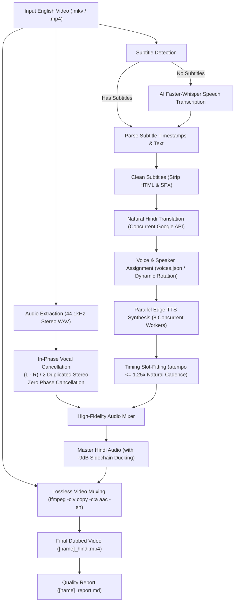

# 🎬 1-Click English to Hindi Video Dubber

[](https://www.python.org/downloads/)
[](https://opensource.org/licenses/MIT)
[](https://ffmpeg.org/)
[](https://github.com/rany2/edge-tts)

Convert **any English video** (TV series, movies, anime, documentaries, or YouTube clips) into a **professional Hindi dubbed video in a single click**.

Zero configuration required. 100% local, free, and blazingly fast.

---

## ✨ Key Features

- **🖱️ True 1-Click Operation:** Drag and drop any video file onto `one_click_dub.bat`, or double-click to open a native file browser.
- **🔊 Zero Acoustic Phase Cancellation:** Advanced center-channel vocal cancellation `(L - R) / 2` duplicated to stereo ensures background music and SFX sound clear on mobile phones and laptop mono speakers without comb-filtering.
- **⚡ Blazingly Fast Synthesis:** Parallel async synthesis (8 workers) using Microsoft Edge-TTS neural voices (`hi-IN-MadhurNeural` & `hi-IN-SwaraNeural`). Dubs an entire 45-minute episode in ~2-3 minutes.
- **🗣️ Natural Conversational Cadence:** Paces speech naturally and strictly caps speedups at **1.25x** so dialogue never sounds robotic, rushed, or like a chipmunk.
- **🎛️ Automated Sidechain Ducking:** Smoothly attenuates background score by `-9 dB` when characters speak (50ms attack, 250ms release), bringing music back up during action and silence.
- **🎞️ Lossless Stream Copy:** Original video stream is copied without re-encoding (`-c:v copy`). Muxing takes only a few seconds with **zero loss in video quality**.
- **📝 Automatic Subtitle Detection & AI Fallback:**
  - Extracts embedded subtitles from MKV/MP4 containers.
  - Reads existing `.srt` subtitle files.
  - Automatically falls back to **Whisper AI** (`faster-whisper`) to transcribe audio if no subtitles exist.
- **📁 Batch Folder Processing:** Dub an entire season or directory of videos with `dub_folder.bat`.

---

## 🛠️ System Architecture



---

## 🚀 Quick Start

### 1. Prerequisites
- **Python 3.9+** installed and added to PATH.
- **FFmpeg** installed and added to PATH ([Download FFmpeg](https://ffmpeg.org/download.html)).

### 2. Installation
Clone the repository and install the dependencies:
```bash
git clone https://github.com/Aishivam1/one-click-video-dubbing.git
cd one-click-video-dubbing
pip install -r requirements.txt
```

---

## 🎮 How to Use

### Method 1: 1-Click Drag & Drop (Recommended)
1. Find any `.mkv`, `.mp4`, or `.avi` video in Windows Explorer.
2. **Drag the video and drop it directly onto `one_click_dub.bat`**.
3. The dubber automatically runs and saves `[video_name]_hindi.mp4` when finished.

### Method 2: Double-Click File Picker
1. Double-click `one_click_dub.bat`.
2. A Windows file selection dialog will pop up.
3. Select your video file and click **Open**.

### Method 3: Command-Line Interface (CLI)
```bash
python auto_dubber.py "path/to/your_video.mkv"
```

Optional arguments:
```bash
# Specify custom output path
python auto_dubber.py "input.mp4" --output "output_hindi.mp4"

# Specify custom voices file
python auto_dubber.py "input.mp4" --voices "custom_voices.json"
```

### Method 4: Batch Dub an Entire Season / Folder
Drag a folder with multiple videos onto `dub_folder.bat` (or run it inside the folder) to process all episodes automatically.

---

## 🎭 Customizing Character Voices (`voices.json`)

You can assign specific Indian neural voices to any character in `voices.json`:
```json
{
  "speakers": {
    "Barry Allen": {
      "character_name": "Barry Allen",
      "voice_config": {
        "voice": "hi-IN-MadhurNeural",
        "rate": "-6%",
        "pitch": "-10Hz"
      }
    },
    "Caitlin Snow": {
      "character_name": "Caitlin Snow",
      "voice_config": {
        "voice": "hi-IN-SwaraNeural",
        "rate": "+2%",
        "pitch": "+8Hz"
      }
    }
  }
}
```

### Available Neural Voices
- **Male Lead:** `hi-IN-MadhurNeural`
- **Female Lead:** `hi-IN-SwaraNeural`

Modify `rate` (`-10%` to `+15%`) and `pitch` (`-25Hz` to `+15Hz`) to create distinct, expressive character voices.

---

## 📁 Repository Structure

```
├── auto_dubber.py             # Master 1-click autonomous dubbing pipeline
├── one_click_dub.bat          # Windows 1-click drag-and-drop / GUI launcher
├── dub_folder.bat             # Batch folder converter
├── audio_mixer.py             # Center vocal cancellation & sidechain ducking
├── timing_fitter.py           # Duration measurement & atempo slot fitting
├── export_video.py            # Stream-copy lossless video muxer
├── generate_report.py         # Markdown quality report generator
├── voices.json                # Master character voice registry
├── requirements.txt           # Python package dependencies
├── ONE_CLICK_DUBBING_GUIDE.md # Detailed usage manual
├── LICENSE                    # MIT License
└── README.md                  # Project documentation
```

---

## 🤝 Contributing

Contributions, issues, and feature requests are welcome! Feel free to check the issues page or submit a pull request.

---

## 📄 License

This project is licensed under the MIT License - see the [LICENSE](LICENSE) file for details.
